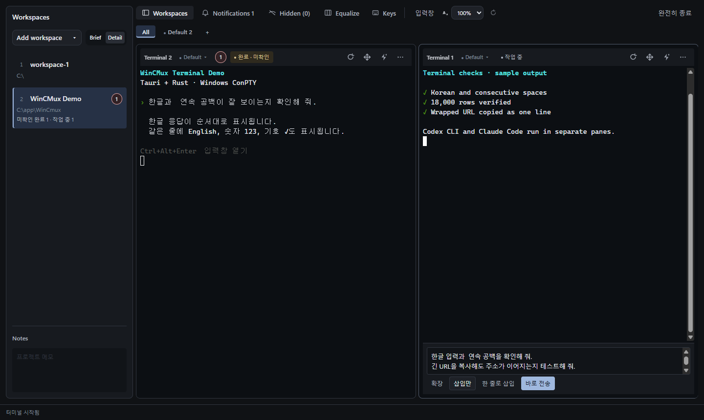
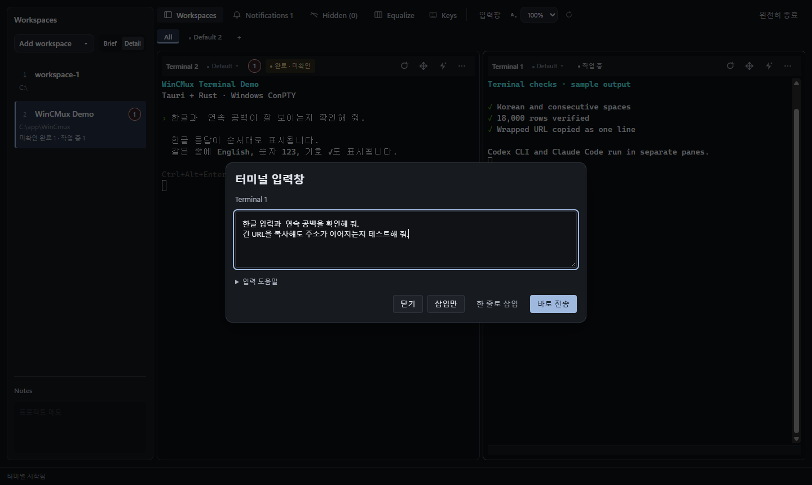
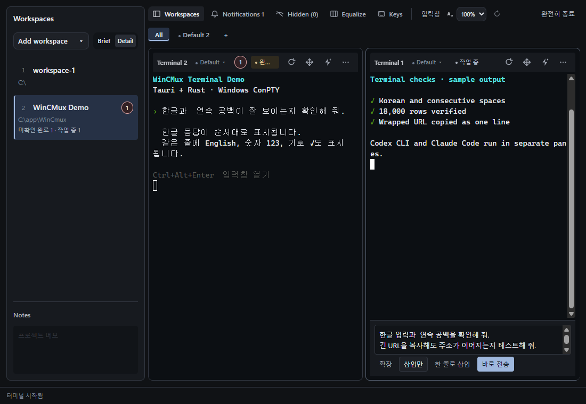

# WinCMux

[English](README.md) · [Windows 빌드](../../actions) · [성능 평가](docs/evaluation.md)

WinCMux는 Codex CLI, Claude Code, PowerShell 등을 여러 pane에서 쓰는 Windows 터미널 앱입니다. Tauri·WebView2·xterm.js 화면을 Rust와 Windows ConPTY에 연결합니다. 설치된 앱은 자체 코어를 실행하는 데 Node.js가 필요 없습니다.



*WinCMux Tauri 0.2.1에서 임시 워크스페이스와 예제 출력을 사용해 캡처한 화면입니다.*

- 터미널을 분할하고 워크스페이스와 그룹으로 정리합니다. 실행 중인 pane을 숨겼다가 다시 열 수 있습니다.
- 선택한 pane 하단 입력창에서 작성하고 **Ctrl+Enter** 또는 **바로 전송**으로 내용을 넣고 제출합니다. pane별 초안은 전환 및 분할 시 유지됩니다. **확장** 또는 **Ctrl+Alt+Enter**로 큰 입력창을 엽니다.
- 여러 화면 줄에 걸친 URL을 선택해 **Ctrl+C**를 누르면 주소가 한 줄로 복사됩니다. 일반 텍스트의 줄바꿈은 유지됩니다.
- 세션 기록과 Codex·Claude 재개 명령을 찾고, Windows 알림과 워크스페이스의 에이전트 지침·텍스트·이미지 자료를 관리합니다.



**바로 전송**과 **Ctrl+Enter**는 줄바꿈을 유지해 붙여넣고 Enter로 제출합니다. **삽입만**은 내용을 넣고 제출을 기다립니다. 입력창을 비운 상태에서 **터미널 제출**을 누르면 터미널의 현재 입력을 제출합니다. 여러 줄 붙여넣기를 지원하지 않는 세션에서는 **한 줄로 삽입** 후 **터미널 제출**을 누르세요.

## 0.2.1 변경점

화면과 실행 코어를 분리했습니다. **창의 X 버튼은 화면만 닫고**, 터미널·셸·에이전트·개발 서버는 `wincmux-core.exe`에서 계속 실행됩니다. 다시 열면 기존 작업과 터미널 화면에 연결됩니다. 화면이 닫힌 동안에는 전용 WebView2를 유지하지 않습니다.

| 상황 | 동작 |
|---|---|
| X 버튼·Alt+F4 또는 화면 앱 충돌 | 실행 중인 작업 유지 |
| 다시 실행 | 기존 세션·화면·숨긴 터미널·미확인 결과 복원 |
| 승인 대기·완료 | Windows 알림과 트레이로 확인, 클릭해서 해당 작업으로 이동 |
| 화면과 실행 중인 터미널이 모두 없음 | 30초 후 코어 종료 |
| ‘완전히 종료’ | 실행 중인 터미널 수 확인 후 전체 종료 |
| 작업 실행 중 업데이트·삭제 | 작업을 강제 종료하지 않고 설치·삭제 중단 |

PC 재부팅·로그아웃·코어 자체 충돌 후 프로세스를 되살리는 기능은 포함하지 않습니다. 다음 실행에서 이전 작업의 종료 사실을 표시하며, 기록된 명령이나 대화 재개를 사용자가 선택합니다.

화면은 색상·글꼴·상태·간격을 디자인 토큰으로 관리합니다. 4px 간격과 공통 모서리를 사용하고, 작업 중 상태와 결과 확인 버튼을 구분했습니다. 반복 설명은 도움말과 툴팁으로 옮겼습니다. [디자인 점검과 컴포넌트 규칙](docs/ui-design.md)

<details>
<summary>좁은 화면 보기 — 1100×760</summary>



</details>

## 백그라운드 실행 확인

1. WinCMux의 PowerShell 터미널에서 아래 명령을 실행하고 첫 PID를 기록합니다.

   ```powershell
   $PID
   while ($true) {
     Get-Date -Format 'HH:mm:ss'
     Start-Sleep 2
   }
   ```

2. X 버튼으로 창을 닫고 작업 관리자 → 세부 정보에서 `wincmux-tauri.exe`가 종료되고 `wincmux-core.exe`와 기록한 PowerShell PID가 유지되는지 확인합니다.
3. 10초 후 다시 열어 닫혀 있던 동안의 출력이 이어지는지 확인합니다. `Ctrl+C` 후 `$PID`가 처음 값과 같으면 같은 작업에 재연결된 것입니다.
4. 충돌 상황은 작업 관리자에서 **`wincmux-tauri.exe`만** 종료한 뒤 같은 방법으로 확인합니다.

자동 테스트에서는 정상·강제 종료, 숨긴 세션, 알림 이동, 정상·대체 화면 복원과 업데이트 보호를 확인했습니다. 코어 분리 전후 3회 측정에서 6개 패널의 앱·코어 메모리 증가 중앙값은 10.35MiB였습니다. 화면 없는 코어는 테스트 터미널 6개에서 6.94MiB, 60초 유휴 CPU는 0.155%였습니다. 실제 Codex·Claude의 메모리나 응답 속도를 뜻하지 않습니다. [측정 조건·결과·한계](docs/background-core-evaluation.md)

## 초기 Electron → Tauri 전환 측정

같은 Windows PC에서 두 번씩 실행했을 때 x64 설치 파일은 **95.61 MiB → 3.66 MiB**, pane 6개 기준 앱·코어 메모리는 **491–504 MiB → 391 MiB**, 선택 pane의 입력 왕복 P95는 **16.0–16.3 ms → 10.1–11.3 ms**였습니다. 두 구현 모두 한글, 연속 공백, **18,000줄의 출력**을 보존했습니다. [측정 조건과 검증 범위](docs/evaluation.md)

현재 백그라운드 코어 분리의 3회 비교는 [코어 평가](docs/background-core-evaluation.md), 0.2.1 화면 정리는 [디자인 점검](docs/ui-design.md)을 참고하세요.

## Windows에서 개발하고 빌드하기

Node.js 20 이상, Rust MSVC 도구 체인과 rustfmt, Visual Studio C++ Build Tools, WebView2가 필요합니다.

```powershell
npm ci
npm run dev
npm run lint
npm test
npm run package:win
npm run test:ui
npm run test:runtime
npm run test:lifecycle
```

x64 NSIS 설치 파일은 `apps/desktop-tauri/src-tauri/target/release/bundle/nsis/`에 생성됩니다. UI 테스트는 빌드된 릴리스 실행 파일과 임시 WebView2 프로필을 사용합니다.

DB는 `%APPDATA%\WinCMux-Tauri\wincmux.db`에 저장됩니다. 이전 SQLite DB를 가져오려면 두 앱을 종료하고 해당 위치에 복사하세요. Electron 소스는 Git 태그 [v0.1.0](../../tree/v0.1.0)에서 확인할 수 있습니다.

[아키텍처](docs/architecture.md) · [기능](docs/features.md) · [JSON-RPC 브리지](bridge/README.md)

창을 닫아도 터미널 작업은 백그라운드 코어에서 계속 실행됩니다. 다시 열면 기존 작업에 연결됩니다. 모든 작업을 끝내려면 **완전히 종료** 또는 트레이 메뉴를 사용하세요. 업데이트·삭제 전에 실행 중인 터미널을 종료해야 합니다. [구조 설명](docs/architecture.md)을 참고하세요.

## 참고 자료

[참고한 제품·설계 지침과 적용 범위](docs/references.md)에 Herdr, Fluent 2, Tauri 및 터미널 화면 복원 자료를 정리했습니다.
