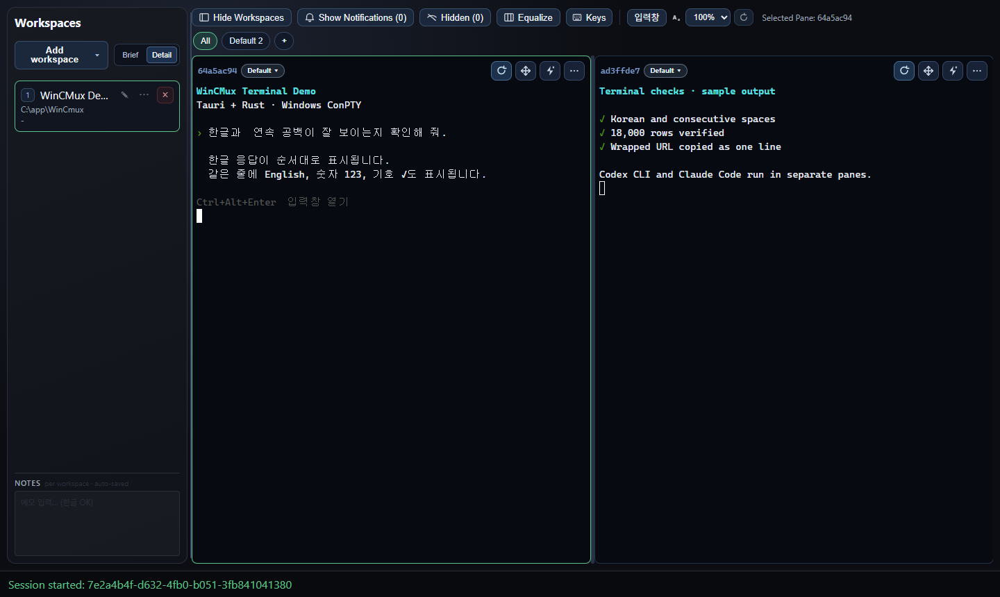
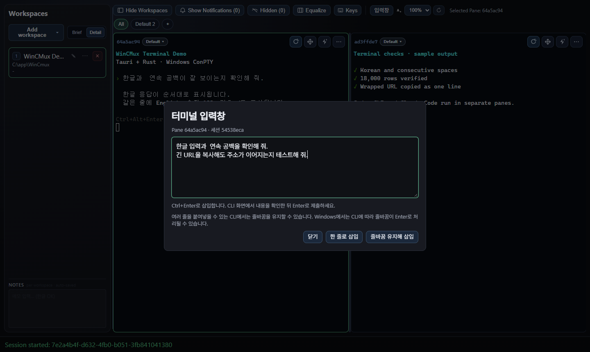

# WinCMux

[English](README.md) · [Windows 빌드](../../actions) · [성능 평가](docs/evaluation.md)

WinCMux는 Codex CLI, Claude Code, PowerShell 등을 여러 pane에서 쓰는 Windows 터미널 앱입니다. Tauri·WebView2·xterm.js 화면을 Rust와 Windows ConPTY에 연결합니다. 설치된 앱은 자체 코어를 실행하는 데 Node.js가 필요 없습니다.



*WinCMux Tauri 0.1.1에서 임시 워크스페이스와 예제 출력을 사용해 캡처한 화면입니다.*

- 터미널을 분할하고 워크스페이스와 그룹으로 정리합니다. 실행 중인 pane을 숨겼다가 다시 열 수 있습니다.
- **Ctrl+Alt+Enter**로 한글 입력창을 열고 **Ctrl+Enter**로 선택한 터미널에 초안을 넣습니다. CLI에서 확인한 뒤 Enter로 제출합니다.
- 여러 화면 줄에 걸친 URL을 선택해 **Ctrl+C**를 누르면 주소가 한 줄로 복사됩니다. 일반 텍스트의 줄바꿈은 유지됩니다.
- 세션 기록과 Codex·Claude 재개 명령을 찾고, Windows 알림과 워크스페이스의 에이전트 지침·텍스트·이미지 자료를 관리합니다.



입력창의 기본 버튼과 **Ctrl+Enter**는 줄바꿈을 유지해 삽입합니다. 여러 줄 붙여넣기를 지원하지 않는 세션에서는 **한 줄로 삽입**을 선택할 수 있습니다.

## 개선 결과

같은 Windows PC에서 두 번씩 실행했을 때 x64 설치 파일은 **95.61 MiB → 3.66 MiB**, pane 6개 기준 앱·코어 메모리는 **491–504 MiB → 391 MiB**, 선택 pane의 입력 왕복 P95는 **16.0–16.3 ms → 10.1–11.3 ms**였습니다. 두 구현 모두 한글, 연속 공백, **18,000줄의 출력**을 보존했습니다. [측정 조건과 검증 범위](docs/evaluation.md)

## Windows에서 개발하고 빌드하기

Node.js 20 이상, Rust MSVC 도구 체인과 rustfmt, Visual Studio C++ Build Tools, WebView2가 필요합니다.

```powershell
npm ci
npm run dev
npm run lint
npm test
npm run package:win
npm run test:ui
```

x64 NSIS 설치 파일은 `apps/desktop-tauri/src-tauri/target/release/bundle/nsis/`에 생성됩니다. UI 테스트는 빌드된 릴리스 실행 파일과 임시 WebView2 프로필을 사용합니다.

DB는 `%APPDATA%\WinCMux-Tauri\wincmux.db`에 저장됩니다. 이전 SQLite DB를 가져오려면 두 앱을 종료하고 해당 위치에 복사하세요. Electron 소스는 Git 태그 [v0.1.0](../../tree/v0.1.0)에서 확인할 수 있습니다.

[아키텍처](docs/architecture.md) · [기능](docs/features.md) · [JSON-RPC 브리지](bridge/README.md)
