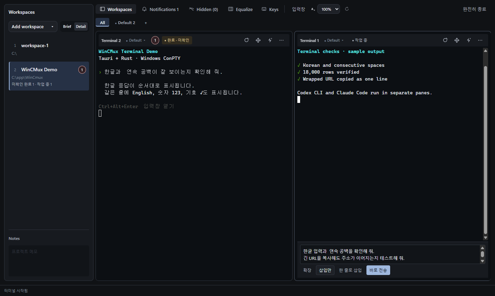
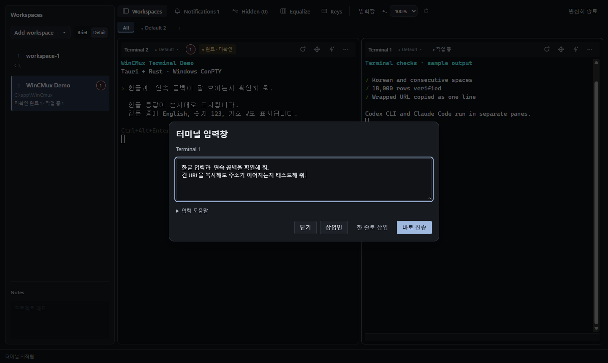
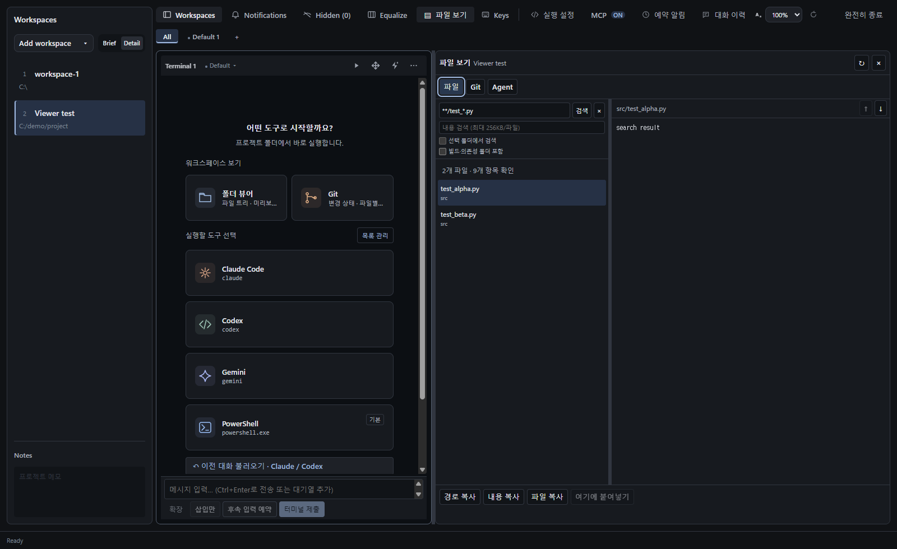
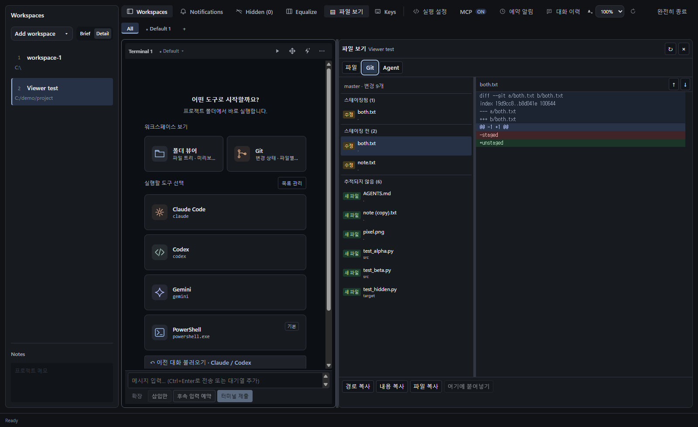
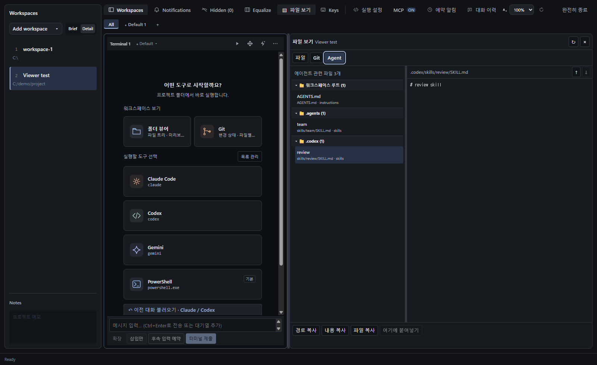
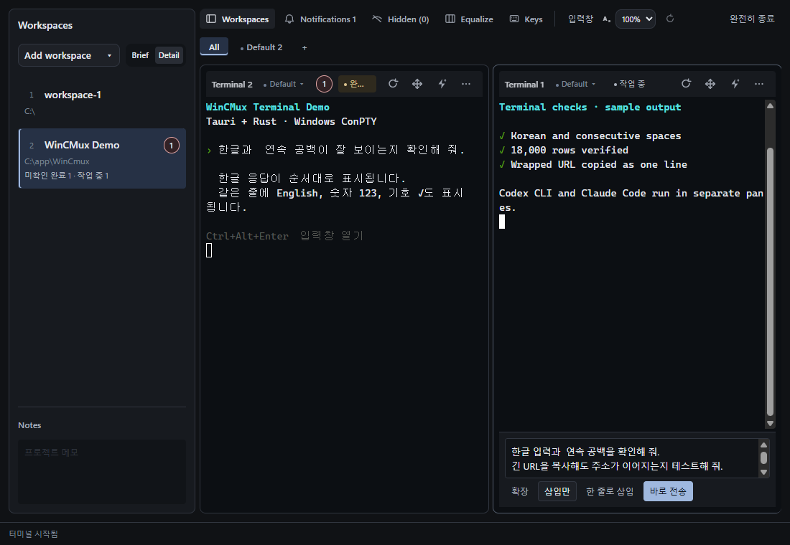

# WinCMux

[한국어](README.kr.md) · [Latest Windows x64 installer](https://github.com/sungreong/wincmux/releases/latest) · [Changelog](CHANGELOG.md) · [Windows builds](../../actions) · [Performance evaluation](docs/evaluation.md)

WinCMux is a Windows terminal workspace for Codex CLI, Claude Code, PowerShell, and other CLI tools. It uses Tauri, WebView2, xterm.js, and a Rust core built on Windows ConPTY. The installed app runs its core without Node.js.



*WinCMux terminal workspace with sample terminal output.*

- Run independent terminals in split panes and organize them into workspaces and groups. New and split panes stay in their group. Hide and reattach running panes.
- Write in the editor below the selected pane. Press **Ctrl+Enter** or **전송 / 대기열** to queue a message for that pane's agent. It sends when the agent is ready and otherwise waits for completion. Drafts follow each pane through selection and splitting.
- Select a wrapped URL and press **Ctrl+C** to copy one address. Ordinary multiline selections retain their line breaks.
- Click plain HTTP/HTTPS URLs or OSC 8 hyperlinks in local, SSH, and Docker terminals to open them in the Windows default browser.
- The top toolbar uses a single row of icon buttons with hover descriptions and shortcuts. Use **Display settings** to choose Korean or English, adjust the main terminal font size, and enable optional WebGL rendering. The language choice is saved and shared across the main, Docker, and SSH windows. WebGL starts off and falls back to the built-in renderer if unavailable.
- Reopen recorded sessions, resume Codex and Claude conversations, receive Windows notifications, and manage workspace instructions, text snippets, and images.
- Schedule a one-time follow-up when an agent is ready or at a chosen time. Hooks are optional; when connected, their completion signal takes priority. See [detection and delivery conditions](docs/agent-hooks.md).



The per-pane queue appears above the editor and submits messages in order. Submitted and cancelled entries disappear immediately. Failed entries can be restored to the editor or dismissed. In a terminal without an agent, **Ctrl+Enter** submits directly. **삽입만** pastes the draft. With an empty editor, **터미널 제출** submits the terminal's existing input.

## Local Docker workspaces

Open **로컬 Docker** to list the running Linux containers on this PC. Choose a container and use the folder icon to open a project folder inside it. The terminal, file viewer, content search, and Git views use that folder. WinCMux saves the last container and folder on this PC. Refresh the list from the container picker when the engine or containers change.

## Remote SSH workspaces

Open **원격 SSH** from the toolbar. Choose an alias from Windows OpenSSH's `%USERPROFILE%\.ssh\config`, or enter the host, username, port, and optional private key. **연결 테스트** reports the test result on the setup screen. **연결** opens the remote workspace and adds the server to the saved list. The password prompt can remember a successful password in Windows Credential Manager when connecting.

Use **VS Code에서 SSH 설정 열기** to edit `config`. Alias changes appear when WinCMux regains focus or you click **목록 새로 고침**. After testing a manual connection, use **Windows SSH에 저장** to register it as an alias.

After connecting, pick a server folder or use **Docker 컨테이너 접속** beside the target selector to open a container in its own tab. Closing that tab ends its attached terminals. The container and SSH connection stay running. Use the **폴더 저장** icon to reopen the same location on the next SSH connection. The remote account needs access to `docker`, and the container must provide `sh`.

Docker **+ Shell** starts Bash when available in the container, enabling Tab filename completion; otherwise it uses `sh`. Open a new shell or run `exec bash -i` in an existing one to switch.

In SSH and local Docker tabs, use a pane's **Move** icon (Ctrl+Alt+P) to place its terminal to the left, right, above, or below another pane. Use **균등 배분** above the panes to restore equal split sizes.

In the SSH and local Docker file viewer, the file or Git list stays in a left sidebar while the selected file or search results appear on the right.

Use **+ Claude Code**, **+ Codex**, or **+ Gemini** to start an agent in the selected environment. Prompt input waits for the agent's terminal to accept the next message. If WinCMux cannot find the CLI, it shows the official install command, required tools, and a version check. **Install in shell** opens a terminal in that SSH server or Docker container and runs the installer and version check. You can still copy the command for manual installation, then use **Retry** to start the agent. Installation needs internet access. Gemini CLI also needs Node.js 20 or later and npm. [Claude Code setup](https://code.claude.com/docs/en/setup) · [Codex CLI installation](https://learn.chatgpt.com/docs/codex/cli) · [Gemini CLI installation](https://geminicli.com/docs/get-started/installation/)

Use **대화 이력** above the terminals to find and resume Claude or Codex conversations stored in the selected Docker container or SSH server. Search, date filters, sorting, favorites, hiding, compact view, and pagination are available. The environment needs Python 3 for discovery; original transcript files are never changed.

SSH and local Docker panes fit the window height. Output scrolls inside the pane, with the composer below it. Pane icons split right or down, adjust the font, open the file viewer for the pane's folder, and close the pane. `Ctrl+Alt+Q` closes the focused pane. The bell opens completion, input-request, and usage-limit alerts. The clock opens scheduled reminders.

**VS Code에서 열기** opens the workspace on the same Windows SSH alias with the VS Code Remote - SSH extension. For a container workspace, use **Dev Containers: Attach to Running Container** in the VS Code remote window.

## MCP control

MCP tools and screen capture are available for local workspaces. SSH and container workspaces open in a separate desktop window outside that scope.

Open **MCP** in the toolbar to copy the local server command and inspect supported tools. An MCP client can list workspaces and terminal panes, create and rename groups, open a visible PowerShell or agent terminal directly in a group, split or focus a pane, read terminal output, and queue follow-up prompts. See the [MCP tool guide](bridge/mcp/README.md) for tool arguments and connection steps.

## Workspace viewer

Select a workspace and click **파일 보기** in the toolbar. The viewer opens beside the terminal without starting another terminal. You can also open its tabs from the workspace quick actions: **Files**, **Git diff**, or **Agent Assets**.

**Files** shows a folder tree with text, image, and Markdown previews. Search by filename or path pattern, optionally add a text query, and select a folder to limit the search to that folder. Code previews show the detected language and syntax colors; use language search to switch grammars and **Ctrl+F** to search within a file. To copy a file, select it and click **파일 복사**, then select a destination folder and click **여기에 붙여넣기**. Refresh retains expanded folders and the selected item. Content search reads at most 256 KB per file and 20 MB in total, with a five-second search limit.



**Git** pages large change lists and separates staged, unstaged, and untracked files. Select a change to see its color-coded diff; a file with both staged and unstaged edits appears in both groups. **Agent** groups existing agent files by their actual workspace folder, such as `.agents`, `.codex`, and `.claude`. Expand or collapse each folder, open a file in the preview, and save editable files. Use the list's arrow keys or the preview's arrows and **Alt+↑/↓** to move between files.





## Background core and window closing

Local Windows terminals run in the background core. Choosing **Close window** from the main window's X dialog ends the UI while `wincmux-core.exe` keeps local shells, agents and development servers running. Reopening reconnects to the same jobs and terminal screen. SSH and Docker terminal connections belong to their workspace windows.

| Situation | Behavior |
|---|---|
| Window X or Alt+F4 | Choose Fully quit, Close window, or Cancel |
| UI crash | Live terminal jobs continue |
| Reopen | Restore sessions, screens, hidden terminals and unread results |
| Approval needed or task completed | Native notifications and tray state; click to return to the task |
| No UI, live terminals or pending reminders | Core exits after 30 seconds |
| **Fully quit** in the X dialog | End live terminal jobs and child processes |
| Install/update/uninstall with live jobs | Stop installation/removal instead of killing jobs |

Reboot, logoff and a core crash do not preserve processes. A new core marks prior jobs exited; command or conversation resumption remains an explicit user choice.

The UI uses semantic design tokens, a 4px spacing scale and shared radii. Read-only agent states are distinct from result acknowledgement buttons. Optional guidance is folded into help and tooltips. See the [design review and component rules](docs/ui-design.md).

<details>
<summary>Compact layout — 1100×760</summary>



</details>

## Verify background execution

1. Run this in a WinCMux PowerShell terminal and note the initial PID:

   ```powershell
   $PID
   while ($true) {
     Get-Date -Format 'HH:mm:ss'
     Start-Sleep 2
   }
   ```

2. Close the window using X. In Task Manager → Details, verify that `wincmux-tauri.exe` exits while `wincmux-core.exe` and that PowerShell PID remain.
3. Reopen after ten seconds. Output should include the time while the UI was closed. Press `Ctrl+C`; `$PID` should still match.
4. To check UI-crash recovery, terminate **only `wincmux-tauri.exe`** and repeat.

Automated checks cover normal/forced UI exit, hidden sessions, notification navigation, normal/alternate screen restoration and update protection. The three-run comparison measured a median 10.35MiB increase in combined app/core memory with six panes. The native background core used 6.94MiB with six test terminals and 0.155% CPU over 60 idle seconds. These figures exclude the actual Codex/Claude workload. See [conditions, results and limits](docs/background-core-evaluation.md).

## Earlier Electron → Tauri migration

In two runs on the same Windows PC, the x64 installer went from **95.61 MiB** to **3.66 MiB**. With six panes, app and core private memory went from **491–504 MiB** to **391 MiB**, and selected-pane input round-trip P95 went from **16.0–16.3 ms** to **10.1–11.3 ms**. Both builds preserved Korean, repeated spaces, and all **18,000 output lines** in the test. See the [measurement setup and limits](docs/evaluation.md).

See the [background-core evaluation](docs/background-core-evaluation.md) for the three-run runtime comparison and the [0.2.1 UI review](docs/ui-design.md) for the current design changes.

## Develop on Windows

Install Node.js 20 or later, Rust with the MSVC toolchain and rustfmt, Visual Studio C++ Build Tools, and WebView2.

```powershell
npm ci
npm run dev
npm run lint
npm test
npm run package:win
npm run test:ui
npm run test:runtime
npm run test:lifecycle
```

The x64 installer is generated under `apps/desktop-tauri/src-tauri/target/release/bundle/nsis/`. The UI smoke test uses the packaged build's executable and an isolated WebView2 profile.

The database lives at `%APPDATA%\WinCMux-Tauri\wincmux.db`. To carry over a previous SQLite database, close both apps and copy it to that location. The Electron source is available at tag [v0.1.0](../../tree/v0.1.0).

[Architecture](docs/architecture.md) · [Features](docs/features.md) · [JSON-RPC bridge](bridge/README.md)

Finish running terminals before installing or uninstalling an update. In the main window, use **완전히 종료** or the tray menu to end local Windows terminal jobs. See [architecture](docs/architecture.md).

## References

See [references and their implementation scope](docs/references.md) for Herdr, Fluent 2, Tauri and terminal-state sources.
