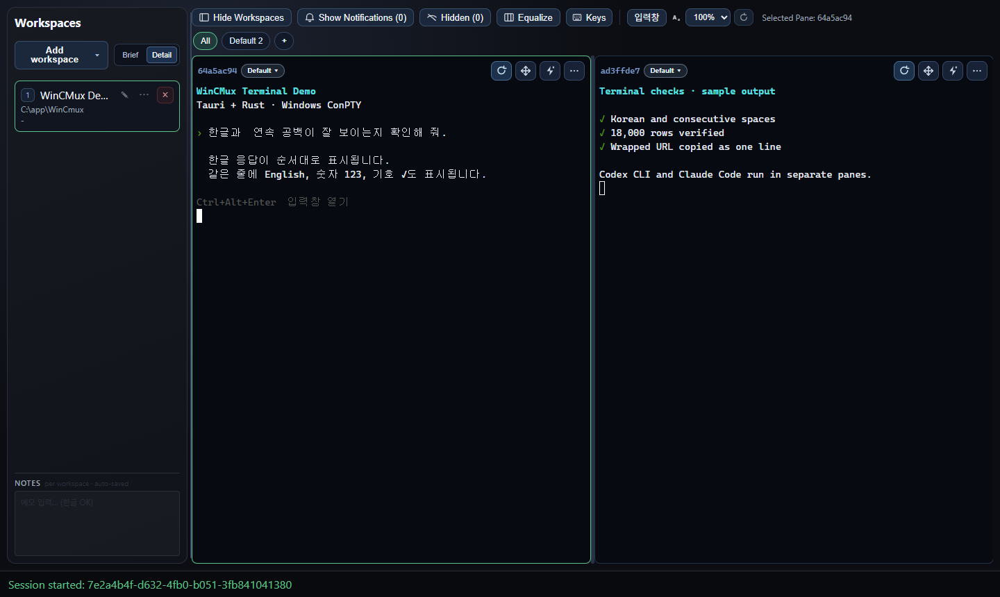
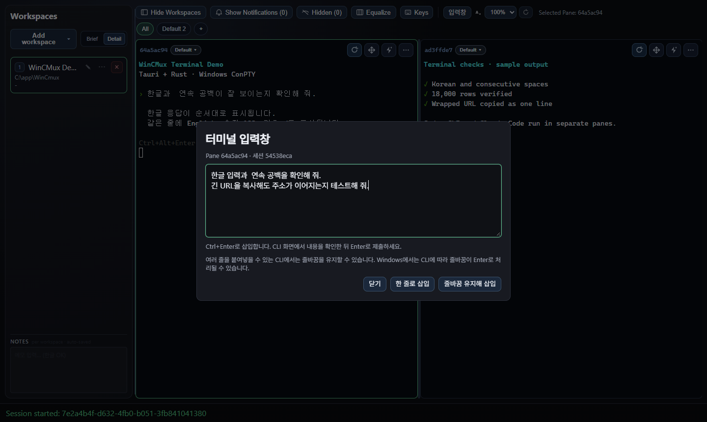

# WinCMux

[한국어](README.kr.md) · [Windows builds](../../actions) · [Performance evaluation](docs/evaluation.md)

WinCMux is a Windows terminal workspace for Codex CLI, Claude Code, PowerShell, and other CLI tools. It uses Tauri, WebView2, xterm.js, and a Rust core built on Windows ConPTY. The installed app runs its core without Node.js.



*WinCMux Tauri 0.1.4 running an isolated demo workspace with sample terminal output.*

- Run independent terminals in split panes and organize them into workspaces and groups. Hide and reattach running panes.
- Write in the editor below the selected pane. Drafts follow each pane through selection and splitting. Press **Ctrl+Enter** or **바로 전송** to paste and submit. Use **확장** or **Ctrl+Alt+Enter** to open the larger editor.
- Select a wrapped URL and press **Ctrl+C** to copy one address. Ordinary multiline selections retain their line breaks.
- Reopen recorded sessions, resume Codex and Claude conversations, receive Windows notifications, and manage workspace instructions, text snippets, and images.



**바로 전송** and **Ctrl+Enter** preserve line breaks and send a separate Enter to submit. **삽입만** only pastes the draft. With an empty editor, **터미널 제출** submits the terminal's existing input. Choose **한 줄로 삽입** followed by **터미널 제출** for sessions that require a single line.

## What improved

In two runs on the same Windows PC, the x64 installer went from **95.61 MiB** to **3.66 MiB**. With six panes, app and core private memory went from **491–504 MiB** to **391 MiB**, and selected-pane input round-trip P95 went from **16.0–16.3 ms** to **10.1–11.3 ms**. Both builds preserved Korean, repeated spaces, and all **18,000 output lines** in the test. See the [measurement setup and limits](docs/evaluation.md).

## Develop on Windows

Install Node.js 20 or later, Rust with the MSVC toolchain and rustfmt, Visual Studio C++ Build Tools, and WebView2.

```powershell
npm ci
npm run dev
npm run lint
npm test
npm run package:win
npm run test:ui
```

The x64 installer is generated under `apps/desktop-tauri/src-tauri/target/release/bundle/nsis/`. The UI smoke test uses the packaged build's executable and an isolated WebView2 profile.

The database lives at `%APPDATA%\WinCMux-Tauri\wincmux.db`. To carry over a previous SQLite database, close both apps and copy it to that location. The Electron source is available at tag [v0.1.0](../../tree/v0.1.0).

[Architecture](docs/architecture.md) · [Features](docs/features.md) · [JSON-RPC bridge](bridge/README.md)
