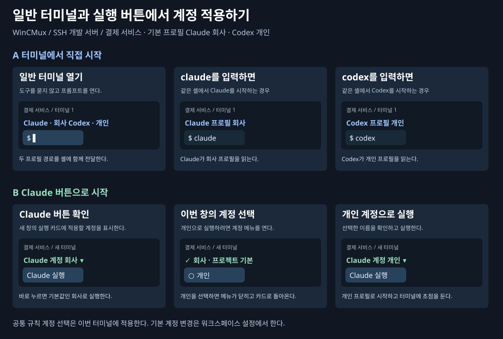
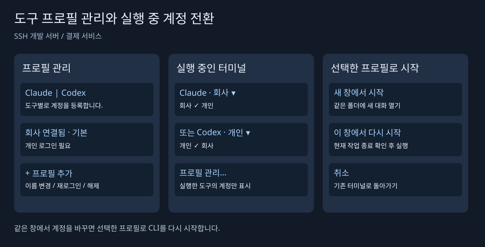

# WinCMux 터미널 계정 선택 기획서

**설계안 · 대상 사용자** 한 SSH 사용자로 같은 프로젝트에서 업무용과 개인용 Claude 계정을 번갈아 쓰는 개발자. 목표는 터미널에서 평소처럼 `claude`를 입력하거나 기존 Claude 실행 카드를 한 번 눌러 예상한 계정으로 시작하는 것이다.

## 구현과 확인 방법

- 로컬은 상단의 사람 모양 **도구 프로필 관리** 버튼에서 등록한다. 워크스페이스 행의 **⋯ → 기본 프로필**에서 Claude와 Codex 기본값을 각각 선택한다.
- SSH·Docker는 작업 폴더를 연 뒤 상단 오른쪽 **⋯ → 도구 프로필 관리**를 사용한다. SSH는 실제 접속 사용자·호스트·포트·호스트 키를 기준으로 등록 목록을 공유한다. 컨테이너는 실행 대상 ID별로 목록을 분리한다. 같은 접속 대상에서 폴더마다 기본값을 달리 설정할 수 있다.
- **등록하고 로그인**은 전용 터미널에서 CLI 로그인을 연다. 관리 목록에서 **상태 확인**을 누르면 해당 프로필 환경으로 CLI의 인증 상태를 확인한다. 이름 변경은 별칭만 수정한다. 등록 해제 시 해당 프로필을 기본값으로 사용하는 작업공간들의 대체값을 선택한다.
- **+ 셸**로 열면 두 도구의 프로필을 함께 적용한다. **+ Claude Code** 또는 **+ Codex** 옆의 ▾를 누르면 이번에 쓸 계정을 바로 고를 수 있다. 이름을 붙인 로그인 프로필을 사용한 셸에서는 해당 도구의 상속된 인증 토큰 환경변수를 해제한다. 다른 애플리케이션에서 같은 API 키를 사용해야 하는 셸에는 **환경 기본**을 선택한다.
- 실행 중인 도구 이름 옆의 ▾에서 다른 프로필을 골라 새 창에서 열거나 명시적으로 현재 작업의 종료를 확인하고 다시 시작한다. 대상 인증 상태를 확인한 후 실행한다. Linux 원격 셸에서 직접 입력한 도구는 전경 프로세스 그룹을 확인해 표시한다. 사용자가 부여한 별칭은 인증 서비스에서 반환한 이메일 주소와 다를 수 있다.
- 자동 검증은 `npm run build` 후 `npm run test:accounts`로 실행한다. Docker 시나리오는 로컬의 `python:3.12-slim` 이미지와 실행 중인 Docker 엔진을 사용하며 `npm run test:accounts -- --docker`로 실행한다. 네트워크와 볼륨을 연결하지 않은 임시 컨테이너 안에서 테스트 CLI 두 계정의 분리, 등록, 메뉴 배치와 전환을 확인한다.

## 화면과 선택 규칙

| 위치 | 사용자에게 보이는 항목 | 적용 범위 |
|---|---|---|
| 연결 설정 → 도구 계정 | Claude·Codex 계정 추가, 별칭, 로그인, 로그인 상태 확인 | 같은 실행 환경과 OS 사용자 아래에서 프로필 재사용 |
| 워크스페이스 설정 | Claude 기본 계정, Codex 기본 계정 | 이후 새로 여는 터미널의 초기값 |
| 새 터미널의 기존 실행 선택 화면 | 일반 셸 바로 열기, 선택 사항인 도구별 프로필 변경, 도구별 실행 카드 | 현재 열려는 터미널 한 개 |
| 실행 중인 터미널 헤더 | 선택 프로필 이름과 ‘다른 계정으로 새 터미널 열기’ | 같은 서버와 작업 폴더에서 새 창 생성 |

우선순위는 **이번 터미널의 선택 → 워크스페이스 기본 → 기존 환경의 기본 로그인** 순서다. 설정을 한 번도 바꾸지 않은 사용자에게는 ‘환경 기본’으로 표시한다. 등록한 프로필이 삭제됐거나 사용할 수 없으면 해당 이름과 복구 동작을 보여 주고 다른 계정으로 자동 실행하지 않는다.

## 시나리오 A · 터미널에서 직접 입력

1. 일반 터미널을 열면 바로 셸 프롬프트가 뜬다. 어느 CLI를 쓸지 묻지 않는다.
2. 워크스페이스에 Claude는 회사, Codex는 개인으로 지정한 예에서 셸은 CLAUDE_CONFIG_DIR과 CODEX_HOME에 각 프로필 경로를 받는다. 지정하지 않은 도구는 기존 환경을 상속한다.
3. 같은 셸에서 `claude`는 회사, `codex`는 개인 프로필을 읽는다. `git status` 같은 일반 명령도 평소대로 쓴다.
4. 이번 창에서 Claude만 개인으로 쓰려면 ‘다른 계정으로 새 터미널 열기’에서 Claude 항목만 변경한다. Codex는 워크스페이스 기본값을 따른다.

## 시나리오 B · Claude 실행 카드 클릭

1. 동일 프로젝트의 빈 터미널에서 ‘Claude 계정 회사’와 ‘Claude 실행’을 확인한다. 회사로 시작하려면 실행 카드를 한 번 누른다.
2. 개인을 쓰려면 먼저 계정 선택기를 열어 ‘개인’을 고른다. 선택 즉시 표시 이름이 바뀌고 포커스가 실행 영역으로 돌아온다. 이때 CLI는 아직 시작하지 않는다.
3. ‘Claude 실행’을 누르면 해당 프로필로 기존 실행 경로를 호출한다. 기존 훅 등록 안내가 필요하면 같은 프로필로 등록 또는 건너뛰기 후 실행한다. 실행 중 중복 클릭을 막는다.
4. 헤더에는 ‘Claude · 개인’이 표시된다. 이 이름은 선택한 프로필의 별칭이다. 실제 로그인 상태는 CLI 확인 결과가 있을 때 표시한다.

## 첫 로그인과 실패 처리

- 새 프로필의 첫 실행에서는 ‘개인 계정 로그인’을 안내한다. 해당 프로필 환경에서 CLI 공식 로그인을 열고, 성공하면 해당 CLI를 사용한다. 일반 셸을 열 때는 로그인을 요구하지 않는다.
- 로그인 취소는 시작 화면으로 돌아간다. 인증 만료는 선택한 프로필로 재로그인하고, 서버 연결 오류는 같은 서버와 프로필로 재시도한다.
- 관리자 설정이나 상속된 인증 환경변수가 선택한 프로필보다 우선하면 실제 인증 방식과 충돌을 알린다. 별칭만으로 로그인 계정을 단정하지 않는다.

## 개발 인계와 검수 조건

셸과 실행 카드가 동일한 프로필 결정 로직을 사용한다. 프로필에는 실행 대상과 OS 사용자, 도구, 내부 ID, 별칭을 저장한다. 토큰은 CLI가 관리한다. Claude에는 프로필별 CLAUDE_CONFIG_DIR, Codex에는 CODEX_HOME과 파일 자격 증명 저장 설정을 사용한다. 셸 시작, CLI 로그인, 훅 확인, 이전 대화 조회·재개 모두 선택된 프로필을 전달받아야 한다.

로컬은 자식 프로세스 환경, SSH는 원격 셸 환경, Docker는 컨테이너 안의 실행 환경에 적용한다. 컨테이너를 다시 만들어도 로그인 유지가 필요하면 프로필 디렉터리를 영구 볼륨에 둔다. 계정 분리는 CLI 로그인에 적용되며 같은 OS 사용자와 프로젝트의 파일 권한은 공유한다.

| 검수 장면 | 통과 기준 |
|---|---|
| 같은 폴더에서 회사·개인 동시 실행 | 두 창의 CLI 인증 상태가 각각 지정한 테스트 계정과 일치하고 cwd는 같다. |
| 직접 입력과 버튼 비교 | 같은 프로필을 고르면 두 진입점에서 동일 계정으로 인증된다. |
| 변경 중 기존 작업 | 기본 계정을 바꾼 뒤 새 창에만 적용되고 기존 창과 실행 중인 작업은 계속된다. |
| 접근성·좁은 창 | 키보드로 선택·실행하고 Esc로 취소할 수 있다. 긴 별칭은 전체 접근성 이름을 제공한다. |
| 로컬·SSH·Docker | 같은 이름과 조작 순서를 제공하고 각 실행 대상에서 로그인과 이력을 확인한다. |

## Claude와 Codex 프로필 관리

설정의 ‘도구 프로필’에서 현재 실행 대상(로컬 OS 사용자, SSH 접속 사용자 또는 컨테이너 사용자)을 확인한다. Claude와 Codex 탭은 같은 관리 화면을 사용한다. 같은 ‘회사’ 별칭도 두 도구에 따로 등록한다.

| 작업 | 사용자 흐름과 저장 결과 |
|---|---|
| 추가 | 도구 선택 → 별칭 입력 → 전용 프로필 생성 → 해당 환경에서 공식 CLI 로그인 → 상태 확인. 취소하면 ‘로그인 필요’로 남겨 이어서 연결한다. 같은 대상·도구 안의 중복 별칭은 저장 전에 안내한다. |
| 확인과 편집 | 목록에 별칭, 연결 상태, 워크스페이스 기본 여부를 표시한다. 이름 변경, 로그인 상태 확인, 재로그인, 이 프로젝트의 기본으로 지정을 제공한다. 별칭을 바꿔도 내부 ID와 인증 경로는 유지한다. |
| 등록 해제 | 참조하는 워크스페이스와 실행 중인 창을 보여 준다. 기본 프로필이라면 대체값을 선택한다. 확인 후 선택 목록에서 제거하고 인증 파일 삭제와 서비스 로그아웃은 별도 동작으로 둔다. |
| 인증 상태 | 도구가 제공한 인증 상태만 표시한다. ‘회사’는 사용자가 붙인 별칭이다. 인증 주체를 확인할 수 없으면 ‘계정 확인 필요’를 표시한다. 비밀 값은 목록과 로그에 기록하지 않는다. |

## 실행 중 프로필 변경

직접 입력과 실행 카드 모두 같은 헤더를 사용한다. Claude를 실행하면 ‘Claude · 회사 ▾’, Codex를 실행하면 ‘Codex · 개인 ▾’를 표시한다. 헤더를 열면 해당 도구의 프로필 목록과 ‘프로필 관리’로 이동하는 항목이 보인다. 프로필을 바꿀 때 CLI 입력란에 제어 문자열을 보내지 않는다.

1. 현재 창이 어느 도구를 실행하는지 실행 정보와 pane에 연결된 프로세스·훅 신호로 판단한다. 입력이나 출력에 도구 이름만 보이면 후보로만 취급한다. 감지가 불확실하면 일반 ‘도구 프로필’ 메뉴에서 사용자가 도구를 지정한다.
2. 사용자가 새 프로필을 고르면 대상 환경에서 로그인 상태부터 확인한다. 만료·취소·실패 시 원래 작업으로 돌아갈 수 있다.
3. 기본 동작 ‘새 창에서 시작’은 같은 폴더에 선택한 프로필로 새 CLI를 연다. ‘이 창에서 다시 시작’은 현재 작업 종료와 새 대화 시작을 안내한다. 사용자가 확인하면 정상 종료를 요청하고 종료 신호를 확인한 뒤 새 프로필로 실행한다. 종료 확인이 지연되면 원래 창을 유지하고 새 창 열기를 제공한다.
4. 새 프로세스의 실행을 확인한 뒤 헤더를 갱신한다. 전환은 선택한 창과 도구에만 적용한다. 다른 프로필의 대화 이력을 자동으로 넘기지 않는다. 도구 종료 후 일반 셸로 돌아가면 헤더도 셸 상태로 복귀한다.

| 실사용 검수 | 기대 결과 |
|---|---|
| 셸에서 claude 입력 → 회사에서 개인으로 전환 | Claude 프로필만 보이고 개인 Claude가 같은 폴더에서 시작한다. |
| 셸에서 codex 입력 → 개인에서 회사로 전환 | Codex 프로필만 보이고 회사 Codex가 같은 폴더에서 시작한다. |
| Claude·Codex 각각 버튼으로 진입 | 직접 입력한 경우와 같은 등록·관리·전환 동작을 제공한다. |
| 실행 중 전환 취소, 인증 실패 또는 종료 지연 | 기존 작업을 계속 확인할 수 있고 다른 계정으로 실행됐다고 표시하지 않는다. |
| 일반 셸에서 도구 이름이 든 로그 출력 | 실행 중인 도구로 확정하지 않는다. |

Figma 연결은 두 도구에 공통이다. ‘프로필 추가’에서 로그인 화면으로, 터미널 헤더에서 해당 도구의 프로필 목록으로, 대상 선택에서 실행 방식 선택으로 연결한다. ‘취소’는 기존 터미널로 돌아간다.

## Figma 프로토타입 연결

SVG를 Figma 캔버스에 가져와 A1–A3, B1–B3 화면 그룹을 각각 Frame으로 감싼다. 화면에 그린 계정 선택기와 실행 영역에 On click 인터랙션을 연결한다.

- A1 일반 셸에서 입력한 명령에 따라 A2(claude) 또는 A3(codex)로 연결한다.
- B1 계정 선택기 → B2 메뉴. B2 ‘개인’ → B3. B3 ‘Claude 실행’ → A2를 복제한 실행 결과 프레임에 ‘Claude · 개인’을 표시한다. B1에서 바로 실행하는 결과는 ‘Claude · 회사’다.
- 기본 환경에서는 기존 실행 속도를 유지한다. 계정 변경 때만 선택 단계가 추가된다. 실제 서비스 계정의 브라우저 로그인 완료는 해당 계정 소유자가 확인한다.
